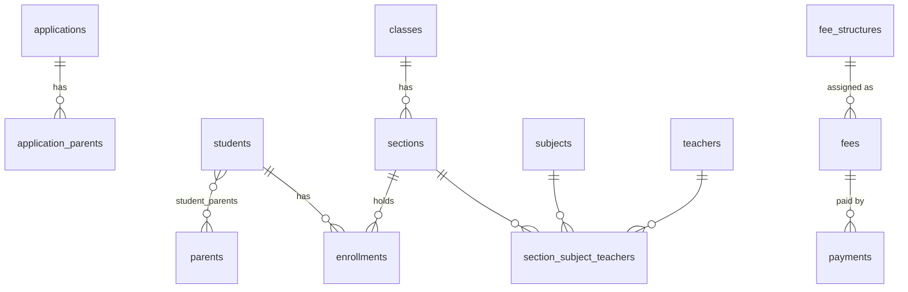

# Database design

One PostgreSQL 16 instance (Amazon RDS in AWS), database `school`, **one schema per service**. A service reaches only its own
schema, and tables never reference another schema with a foreign key. Cross-service references (such as
`fee.fees.student_id`) are plain ids, checked by a REST call to the owning service.

| Schema | Owner service | Tables |
|---|---|---|
| `admission` | Admission | `applications`, `application_parents`, `outbox_events` |
| `student` | Student | `students`, `parents`, `student_parents`, `classes`, `sections`, `subjects`, `teachers`, `section_subject_teachers`, `enrollments` |
| `fee` | Fee | `fee_structures`, `fees`, `payments`, `outbox_events` |
| `attendance` | Attendance | `attendance`, `outbox_events` |
| `notification` | Notification | `notifications` |
| `auth` | Auth | `users` |

Each schema also holds an `alembic_version` table (which migration is applied).

## Relationships inside a schema



## Constraints worth knowing (enforced by the database)

| Table | Constraint | Why |
|---|---|---|
| `fees` | `amount_paid >= 0 AND amount_paid <= amount_due` | A fee can never be overpaid, whatever the code does |
| `fees` | `UNIQUE (student_id, structure_id)` | A fee cannot be assigned twice |
| `payments` | `UNIQUE (idempotency_key)`, `UNIQUE (receipt_no)` | A retried request cannot charge twice |
| `payments` | `amount > 0`, `method IN (...)`, `status IN (...)` | No impossible rows |
| `attendance` | `UNIQUE (subject_type, subject_id, attendance_date)` | One record per person per day |
| `enrollments` | `UNIQUE (student_id, academic_year)` | One section per student per year |
| `section_subject_teachers` | `UNIQUE (section_id, subject_id)` | One teacher per subject per section |
| `students` | `UNIQUE (admission_ref)` | Enrolling an admission twice cannot create two students |
| `notifications` | `UNIQUE (event_id, recipient, channel)` | A redelivered event creates nothing new |
| `sections` | `capacity BETWEEN 1 AND 100` | Sane sizes |
| all status columns | `CHECK (status IN (...))` | Only known states |

## Indexes (besides primary keys and unique constraints)

`applications(status)`, `applications(submitted_at)`, `applications(submitted_by)` · `students(name)`, `students(status)`,
`enrollments(section_id, academic_year)`, `parents(email)` unique, `parents(user_id)` · `fees(student_id)`,
`fees(status, due_date)`, `payments(fee_id)`, `payments(student_id)`, `payments(created_at)` ·
`attendance(attendance_date)`, `attendance(class_name, section_name, attendance_date)` ·
`notifications(status, created_at)`, `notifications(recipient_email)`, `notifications(event_id)` ·
`outbox_events(published_at, created_at)` · `users(role)`, `users(email)` unique and lower-case.

## Roles (least privilege)

| Role | Can | Cannot |
|---|---|---|
| `<svc>_migrator` | create/alter/drop objects in its own schema; used only by the migration Job | see other schemas |
| `<svc>_svc` | SELECT, INSERT, UPDATE on its own schema's tables | DELETE, DROP, CREATE, see other schemas |

## Everyday commands

```bash
# one-time per environment (as the database administrator)
PGHOST=... PGUSER=postgres PGPASSWORD=... PGDATABASE=school scripts/db/bootstrap.sh
# apply migrations (as each service's migrator role)
DB_HOST=... DB_PORT=5432 scripts/db/migrate.sh                    # all services
DB_HOST=... scripts/db/migrate.sh fee                              # one service
# create a new migration after changing a model (review the generated file!)
cd services/fee && DB_HOST=... DB_USER=fee_migrator DB_PASSWORD=... alembic revision --autogenerate -m "add refund table"
alembic current            # which migration is applied
alembic history            # all migrations
alembic downgrade -1       # roll back one step (development only; production rolls forward)
alembic upgrade head --sql # print the SQL instead of running it (for DBA review)
# run the test suites on real PostgreSQL
PGHOST=... PGUSER=... PGPASSWORD=... scripts/db/test-postgres.sh
```

## Production alternatives

- **One instance per service** for isolation of load and failure. Nothing in the code changes (see ADR D14).
- **Multi-AZ RDS, automated backups with point-in-time recovery, encryption at rest (KMS)** and **Performance Insights**
  are Terraform settings (Phase 13).
- **Connection pooling:** each pod keeps up to 5 connections. At scale, RDS Proxy sits between pods and the database.
- **Retention:** `outbox_events` keeps published rows forever for now. A scheduled cleanup job (it needs DELETE on that one table) is a later task.
