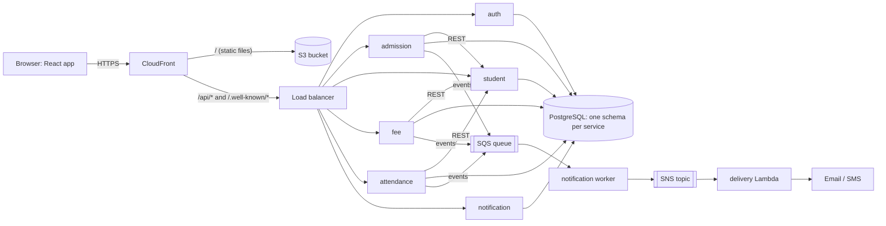
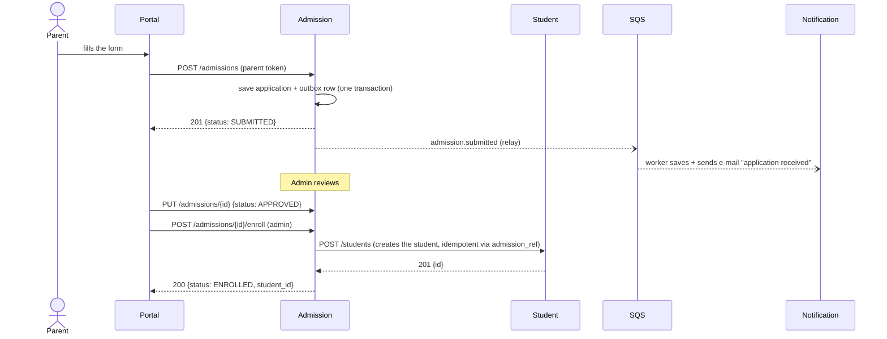

# Developer guide: School Management Platform

Audience: engineers who write the application (Python services, React portal). You do not need to know AWS or Kubernetes to
use this guide; where the platform matters to your code, it says so. The operations side is in
[devops-guide.md](devops-guide.md).

Contents: 1 What the system does · 2 Components · 3 How a request travels · 4 Inside a service · 5 API rules ·
6 Authentication and authorization · 7 Data · 8 Service-to-service calls and events · 9 The three business flows ·
10 Configuration and secrets · 11 Logging and health · 12 Run it on your laptop · 13 Test it · 14 From your keyboard to dev ·
15 Recipes · 16 Frontend · 17 Known limits · 18 Glossary

---

## 1. What the system does

A school portal. **Parents** apply for admission and pay fees. **Teachers** mark attendance. **Administrators** run everything.
Every important event (application received, payment made, student absent) produces a notification (email or SMS).

One React web app talks to six small Python web services. Each service owns one area and its own data.

| Service | Owns | Main endpoints (all under `/api/v1`) |
|---|---|---|
| **auth** | users, passwords, tokens | `POST /auth/login`, `GET /auth/me`, `/users` |
| **admission** | applications, parent contacts | `/admissions`, `PUT /admissions/{id}` (review), `POST /admissions/{id}/enroll` |
| **student** | students, parents, classes, sections, subjects, teachers, enrollments | `/students`, `/classes`, `/sections`, `/subjects`, `/teachers`, `/students/{id}/enrollments` |
| **fee** | fee structures, fees, payments, receipts | `/fee-structures`, `/fees`, `/payments`, `/students/{id}/fees` |
| **attendance** | attendance of students and teachers | `/attendance`, `/attendance/bulk`, `/attendance/summary`, `/students/{id}/attendance` |
| **notification** | notifications and their delivery | `/notifications` (+ a background worker) |

## 2. Components



| Piece | Why it exists |
|---|---|
| CloudFront + S3 | The web app is plain static files. Serving them from a CDN is cheaper, faster and safer than running a server for them. |
| Load balancer | One address for all services; sends each URL path to the right service. |
| One service per area | Teams can change and deploy one area without touching the others. A bug in attendance cannot corrupt fees. |
| One schema per service | Each service is the only writer of its tables. Other services ask through the API; they never read the tables. |
| SQS queue | Producers drop an event and carry on; delivery of a notification can be slow or fail without making a payment fail. |
| SNS + Lambda | Fan-out and the final hop to email/SMS. |

## 3. How a request travels

Example: a parent opens the fees page. The browser calls `GET /api/v1/students/{id}/fees`.

1. **CloudFront** sees `/api/*`, does not cache it, forwards it (with `Authorization` and `X-Request-ID` headers) to the load balancer.
2. **The load balancer** accepts traffic only from CloudFront. It chooses the service by path. Order matters: `/students/{id}/fees` starts with `/students`, so Fee and Attendance rules are checked **before** Student's.

   | Path pattern | Service |
   |---|---|
   | `/api/v1/students/*/fees`, `/api/v1/fees`, `/fee-structures`, `/payments` | fee |
   | `/api/v1/students/*/attendance`, `/teachers/*/attendance`, `/attendance` | attendance |
   | `/api/v1/notifications` | notification |
   | `/api/v1/admissions` | admission |
   | `/api/v1/students`, `/classes`, `/sections`, `/subjects`, `/teachers` | student |
   | `/api/v1/auth`, `/users`, `/.well-known/jwks.json` | auth |

   The same table exists three times: the Vite dev proxy (`frontend/vite.config.js`), the local nginx (`docker/nginx.conf`) and the Kubernetes ingress (`helm/services/*.yaml`). Only the Helm one is covered by automated tests (`helm/tests`: every path goes to the right service, specific before general); **when you add a URL prefix, update all three by hand**.
3. **The pod** (fee service) runs your code, in this order, in `app/main.py` middleware and `app/api/deps.py`:
   request id assigned → token verified → role checked → ownership checked in the SQL query → business logic → response.
4. For this request the fee service also asks the **student service** "may this parent see this child?" (REST call, forwarding the same token).
5. The answer goes back the same way. Every log line along the way carries the same `request_id`.

## 4. Inside a service

Every service has the same layout, so you can move between them.

```
services/fee/
├── app/
│   ├── main.py            builds the FastAPI app: middleware, error handlers, routers, background tasks
│   ├── asgi.py            the entry point uvicorn starts (creates the app from settings)
│   ├── api/               HTTP only: parse the request, call a service, shape the response
│   │   ├── deps.py        dependencies: current user, role guards (AdminOnly, AnyUser ...), DB session
│   │   ├── health.py      GET /health (liveness) and GET /ready (readiness)
│   │   └── v1/            the versioned routers
│   ├── schemas/           Pydantic models: what comes in and goes out (validation lives here)
│   ├── services/          business rules (fee_service.py, payment_service.py), no HTTP and no SQL
│   ├── repositories/      all SQL (SQLAlchemy); the only place that touches tables
│   ├── models/            SQLAlchemy table definitions
│   ├── clients/           calls to other services (student_client.py)
│   ├── config/            settings (environment variables), database engine, Secrets Manager reader
│   ├── utils/             logging, errors, request id, security helpers
│   └── jobs/              one-shot jobs (fee: overdue reminders, run by a Kubernetes CronJob)
├── migrations/            Alembic: database changes, versioned in Git
├── tests/                 pytest (not shipped in the image)
├── requirements.txt       runtime dependencies (pinned)
└── requirements-dev.txt   + pytest, ruff, coverage
```

**The one rule: dependencies point downwards.** `api → services → repositories → models`. An endpoint never contains SQL; a repository never raises an HTTP error; a service never knows about requests. This is what keeps 90%+ test coverage cheap.

## 5. API rules

| Topic | Rule |
|---|---|
| Versioning | Every path starts with `/api/v1`. A breaking change becomes `/api/v2` next to it. |
| Methods | `GET` read, `POST` create (201 + `Location` header), `PUT` change, `DELETE` remove. |
| Status codes | 200 ok · 201 created · 204 no content · 401 no/invalid token · 403 role not allowed · 404 not found **or not yours** · 409 conflict (duplicate, wrong state) · 422 invalid input · 502 another service failed · 503 not ready |
| Lists | `?page=1&page_size=20` plus filters (`status`, `class_id`, `date` ...). Response: `{"items": [...], "total": 42, "page": 1, "page_size": 20}` |
| Errors | Always `{"error": {"code": "validation_error", "message": "...", "request_id": "...", "details": [...]}}`. Never a stack trace. |
| Money | Decimal strings (`"1000.00"`), never floats. |
| Dates | ISO 8601 (`2026-10-24`, `2026-10-24T09:30:00+00:00`). |
| Idempotency | `POST /payments` requires an `Idempotency-Key` header; repeating a request with the same key cannot charge twice. |
| Request id | Send `X-Request-ID` (the browser app does); it comes back in the response and appears in every log line. |
| Docs | Run locally, each service serves its interactive OpenAPI page at `/docs` on its own port (for example http://localhost:8004/docs). The load balancer does not route `/docs`, so it is not exposed in AWS. |

## 6. Authentication and authorization

Three different questions; keep them apart.

| Question | Answered by | How |
|---|---|---|
| Who are you? (**authentication**) | auth service | `POST /auth/login` with email + password returns a JWT, valid 30 minutes |
| What may you do? (**authorization**) | **every** service | role in the token (RBAC) + ownership rules |
| What may this *server* do in AWS? (**IAM**) | AWS | each service's pod has its own IAM role (infra concern, not code) |

**Token.** RS256 (asymmetric). Only the auth service holds the private key and can sign; every other service holds the public key and can only verify. Claims: `sub` (user id), `role` (`admin` | `teacher` | `parent`), `name`, `email`, `iss`, `aud`, `iat`, `exp`, `jti`.

**Roles.** `admin` does everything. `teacher` reads students in their own sections and marks attendance. `parent` sees only their own children's records.

**In code** (fee service example):

```python
# app/api/v1/fees.py  (shape)
@router.post("/fees", ...)
def assign_fee(body: FeeAssign, service: Service, admin: AdminOnly): ...        # 403 for anyone else

@router.get("/students/{student_id}/fees", ...)
def student_fees(student_id: UUID, service: Service, user: AnyUser): ...        # any logged-in user, but...
#   ...the service then checks ownership: a parent gets 404 for a child that is not theirs (not 403: do not confirm it exists).
```
Guards live in `app/api/deps.py`. **Ownership is enforced inside the SQL query** (repositories add the owner filter), so a forgotten check in an endpoint cannot leak another family's data.

**Passwords** are Argon2id hashes; 5 wrong attempts lock the account for 15 minutes; every login failure returns the same message. Never log a password, token or full e-mail address (the logger masks e-mail and phone).

## 7. Data

PostgreSQL 16. **One schema per service, one database login per service.** No foreign keys across schemas: a reference to another service's record (`fees.student_id`) is just an id, validated by calling the owning service.

| Schema | Tables |
|---|---|
| `auth` | `users` |
| `admission` | `applications`, `application_parents`, `outbox_events` |
| `student` | `students`, `parents`, `student_parents`, `classes`, `sections`, `subjects`, `teachers`, `section_subject_teachers`, `enrollments` |
| `fee` | `fee_structures`, `fees`, `payments`, `outbox_events` |
| `attendance` | `attendance`, `outbox_events` |
| `notification` | `notifications` |

Rules the database itself enforces (so a bug cannot break them): a fee cannot be overpaid; a fee cannot be assigned twice to a student; a payment `Idempotency-Key` and receipt number are unique; one attendance row per person per day; a student has one enrollment per academic year. Full list, indexes and ER diagram: [database.md](database.md).

**Changing the schema** = a new Alembic migration in `services/<svc>/migrations/versions/`. Rules:
1. **Expand, then contract.** During a deploy the old and the new version of your code run side by side. A migration must work for both: add a nullable column first; remove the old column in a *later* release.
2. The application's database login cannot create or drop tables. Only the migration job can (a separate login). If your code tries `CREATE TABLE`, it will fail in AWS even if it works on your laptop.
3. Migrations run **before** the new pods start. A failed migration stops the deploy; the old version keeps serving.

```bash
cd services/fee
alembic revision -m "add fee waiver reason" --autogenerate     # then read and edit the file
DATABASE_URL=sqlite:///./local.db alembic upgrade head          # try it
```

## 8. Service-to-service calls and events

**Two ways services talk, chosen by one question: "must the caller wait for the answer?"**

| | Synchronous REST | Asynchronous event |
|---|---|---|
| Use when | the caller needs the answer to continue | the caller only needs to announce something happened |
| Examples | admission → student ("create this student"), fee → student ("does this child exist, is this parent's?") | admission → notification ("application received"), fee → notification ("payment completed") |
| If the other side is down | the call fails; the user gets a clear 502 | the event waits in the queue; nothing is lost |
| Auth | the caller forwards the user's own token | not applicable |

### Events: the outbox pattern

A service must never do "save to database, then send to the queue" as two separate steps: if the second fails, the data changed but nobody was told. Instead:

```
HTTP request ─▶ one DB transaction:  [ business rows ] + [ outbox_events row ] ─▶ commit ─▶ 201 to the user
                                                                   │
              background relay in the same pod (every 2 s) ◀───────┘   reads unpublished rows ─▶ SQS ─▶ marks published
```
Either both rows are saved or neither. The relay may publish an event twice (crash after sending, before marking), so **consumers must be idempotent**: the notification table has `UNIQUE (event_id, recipient, channel)`.

Envelope (identical for every event):
```json
{ "event_id": "uuid", "event_type": "payment.completed", "version": 1,
  "occurred_at": "2026-10-24T09:30:00+00:00", "source": "fee-service", "data": { ... } }
```
| Event type | Producer | Result |
|---|---|---|
| `admission.submitted`, `admission.approved`, `admission.rejected` | admission | e-mail to the parent(s) |
| `payment.completed` | fee | e-mail receipt |
| `fee.overdue` | fee (daily CronJob) | reminder |
| `attendance.absent` | attendance | message to the parent |

### What the consumer does
`notification worker` long-polls SQS → validates the envelope → renders the message from a template → saves a `notifications` row (PENDING) → publishes to SNS → marks SENT/FAILED. A message that is invalid ("poison") is **not** deleted: SQS redelivers it three times, then parks it in the **dead-letter queue**, where an alarm fires. A new producer may send event types the worker does not know; it logs and ignores them.

## 9. The three business flows

Run `scripts/e2e/smoke.py` to watch all of these happen against a real stack.

**Flow 1: admission**

**Flow 2: fee payment.** `POST /fees` (admin assigns a fee to a student) → `POST /payments` with `{fee_id, amount, method}` and an `Idempotency-Key` → fee service locks the fee row, checks the amount, inserts the payment and updates `amount_paid` and `status` (PAID when fully paid) and the outbox row in **one transaction** → 201 with `receipt_no` → event `payment.completed` → e-mail. Paying an already-paid fee returns 409.

**Flow 3: attendance.** Teacher `POST /attendance/bulk` (whole section, one request) or `POST /attendance` (one person). The service asks student whether the teacher may mark this section and whether the student exists, saves one row per person per day (re-marking updates it) and, for ABSENT, writes the `attendance.absent` outbox row → message to the parent.

## 10. Configuration and secrets

Twelve-factor: **all configuration comes from environment variables**; the same image runs everywhere. See `app/config/settings.py`.

| Setting | Local | In AWS |
|---|---|---|
| Database | `DATABASE_URL=sqlite:///...` or `DB_HOST/DB_USER/DB_PASSWORD` | `DB_SECRET_ARN` → the service reads its own login from Secrets Manager at startup |
| Token public key | `JWT_PUBLIC_KEY_FILE=.dev-keys/jwt_public.pem` | `JWT_PUBLIC_KEY_SECRET_ARN` |
| Token private key (auth only) | `JWT_PRIVATE_KEY_FILE` | Secrets Manager |
| Queue / topic | `SQS_QUEUE_URL`, `AWS_ENDPOINT_URL` → a local emulator (moto) | queue URL; real AWS endpoint; credentials from the pod's IAM role |
| Other services | `STUDENT_SERVICE_URL=http://localhost:8003` | `http://student` (Kubernetes service name) |

Rules: **no secret in Git, in an image, or in a Helm values file.** Defaults for secrets do not exist; a missing one stops startup with a clear message. `.env` files and `.dev-secrets/` are git-ignored; a pre-commit-style scan (gitleaks) runs in CI. A secret change reaches a running service only after its pods restart.

## 11. Logging and health

* **Logs are JSON, one object per line, on stdout**: `timestamp, level, logger, message, service, environment, request_id` plus any `extra={...}` fields you pass. Never `print()`; use `logger = logging.getLogger(__name__)`.
* The `request_id` comes from the `X-Request-ID` header (or is generated) and is set for the whole request, including calls to other services and the worker (which uses the event id). **To debug a user report: get the request id from the error response, search all services' logs for it.**
* `GET /health` = "the process is alive" (never touches the DB, otherwise a database outage would make Kubernetes restart healthy pods). `GET /ready` = "I can serve" (runs `SELECT 1`; 503 removes the pod from the load balancer).

## 12. Run it on your laptop

Pick one.

| Way | Command | Needs | Good for |
|---|---|---|---|
| **One service, nothing else** | `cd services/fee && python -m venv .venv && . .venv/bin/activate && pip install -r requirements-dev.txt && pytest` | Python 3.12+ | unit work: tests use throwaway SQLite |
| **Whole platform without Docker** | `scripts/e2e/native-stack.sh start` → http://localhost:5173 | Python, Node | full flows in about a minute (SQLite + a local AWS emulator) |
| **Whole platform in Docker** | `scripts/local-up.sh` → http://localhost:8080 | Docker | closest to AWS (real PostgreSQL, same images, same hardening) |

Log in as `admin@school.example` (the password is printed / the one you chose). Use an address with a real-looking domain: `.local` and `.test` are rejected by validation.

Then `SMOKE_EMAIL=admin@school.example SMOKE_PASSWORD=... scripts/e2e/smoke.py http://localhost:5173` runs every flow and security check against it.

## 13. Test it

| What | Command | Notes |
|---|---|---|
| A service | `cd services/fee && pytest` | **Coverage must stay at or above 85%** (CI fails below). Today 91-97%. |
| Style | `ruff check app tests migrations && ruff format --check app tests migrations` | `ruff format` fixes formatting |
| Frontend | `cd frontend && npm test` | vitest |
| Everything offline | `scripts/e2e/dry-run.sh` | tests, lint, Terraform, Helm, workflows, secret scan |
| Whole flows | `scripts/e2e/dry-run.sh --with-stack` | adds the live smoke test |

What a good test looks like here: it calls the API with `TestClient` (a real HTTP call in memory), not the function; it checks the status code **and** the body **and** the database effect; for security rules it tries the *wrong* role and expects 403/404. Each service has `tests/conftest.py` with ready-made fixtures (tokens for each role, a test database).

## 14. From your keyboard to dev

```
git checkout -b feature/fee-waiver          ──▶ commit ──▶ push ──▶ open a pull request
                                                                       │
                      CI on the pull request (only what you changed):  lint · tests + coverage (SQLite) · tests on real PostgreSQL
                      · tests inside the Docker build · image checks · vulnerability scan · SonarQube quality gate · secret scan
                                                                       │ all green + a review
                                                                  merge to main
                                                                       │
        build image (linux/amd64) · scan · push to ECR tagged with the commit SHA ──▶ bot commits that SHA to helm/environments/dev/fee.yaml
                                                                       │
                                  Argo CD sees the commit ──▶ runs the migration job ──▶ rolls the pods ──▶ dev is updated (≈ 5-10 min)
```
You never run `kubectl`, `docker push` or `terraform` for a normal change. To release further: a person runs the promotion workflow (dev → stage → prod); each is a reviewed pull request. See [devops-guide.md](devops-guide.md) for the machinery.

**Definition of done:** tests for the new behaviour (including the wrong-role case); coverage ≥ 85%; ruff clean; migration is expand-only; no secret or environment-specific value in code; API documented through its Pydantic schemas; logs carry no personal data.

## 15. Recipes

**Add an endpoint** (e.g. `GET /fees/{id}/history` in fee):
1. schema in `schemas/fee.py`; 2. SQL in `repositories/`; 3. rule in `services/`; 4. route in `api/v1/fees.py` with the right guard (`AdminOnly` / `AnyUser`); 5. tests (happy path, 404, wrong role, other family's record); 6. if it is a new URL *prefix*, add it to the three routing tables (Vite, nginx, Helm ingress paths) or it will not be reachable (or will reach the wrong service) in one of the environments. Helm's table has tests; the other two do not.

**Add an event.** 1. In the producer: write the outbox row in the same transaction as the data. 2. In notification: add the type to `services/templates.py` (data schema + message). 3. Test both sides, including "delivered twice creates one notification".

**Call another service.** Add a method to the `clients/` class, forward the caller's token and the `X-Request-ID`, set a timeout, turn failures into a clear 502. Never read the other service's tables.

**Add a setting.** Field in `config/settings.py` with a safe default (not for secrets) → Helm: `helm/services/<svc>.yaml` or the environment values → documented in the table in §10.

**Change the portal.** Page in `frontend/src/pages/`, call the API through `src/api/services.js` (never `fetch` directly), keep the build environment-neutral.

## 16. Frontend

React 18 + Vite, plain JavaScript, no state library. Pages: Login, Dashboard (counts from the real APIs), Admissions, Students, Fees, Payments, Attendance, Notifications, Admin.

* `src/api/client.js` is the only code that calls `fetch`: adds the token and `X-Request-ID`, turns error responses into `ApiError`, and calls the "session over" handler on any 401 (everything logs out).
* `src/api/services.js` has one function per endpoint.
* The token is kept in `sessionStorage` (gone when the tab closes). The stronger production choice is an httpOnly cookie set by auth; noted in the code.
* The app calls the **relative** address `/api/v1/...`. The build therefore contains nothing environment-specific: the same files serve dev, stage and prod, because CloudFront (or the dev proxy) routes `/api` to the right place. Do not add per-environment URLs to the code.
* Buttons for actions a role cannot do are hidden for convenience, but the **server decides**; never rely on the UI for security.

## 17. Known limits (deliberate, see the ADRs)

* A disabled user's token works until it expires (≤ 30 minutes); no refresh tokens, no MFA, no self-service password reset.
* No per-IP rate limiting at the edge yet (AWS WAF is planned, not created).
* Notification delivery by SMS to India needs regulatory registration; e-mail needs a verified sender and leaving the SES sandbox.
* One shared PostgreSQL instance (separate schemas). A production hardening step is one instance per service.
* The three URL routing tables (Vite, nginx, Helm) are kept in step by hand; only Helm's is tested.
* The local stack uses SQLite and an emulator; behaviour that depends on PostgreSQL row locks is tested separately against real PostgreSQL in CI.

## 18. Glossary

| Term | Meaning here |
|---|---|
| ADR | Architecture Decision Record: a short note saying why we chose something (`docs/adr/`) |
| Alembic | Tool that applies database migrations |
| DLQ | Dead-letter queue: where undeliverable messages are parked |
| FastAPI / Pydantic | Web framework / data validation library |
| JWT / RS256 | Signed login token / signing with a private key, verifying with a public key |
| Outbox | Table that records "events to send" in the same transaction as the data |
| RBAC | Role-based access control |
| Idempotent | Doing it twice has the same effect as once |
| Liveness / readiness | "Is the process alive?" / "Can it serve right now?" |
